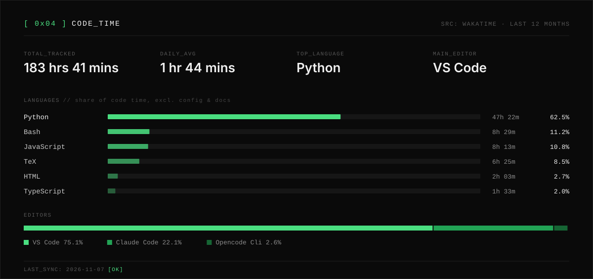

  
  
  

### `[ 0x01 ]` whoami

I'm an AI engineer and researcher, now doing an **MSc in Computer Science (AI) at Leiden University**. For the last two years I was a Delivery Data Analyst at **Turing**, where I worked on **LLM evaluation and fine-tuning** (RAG, RLHF) with international teams. On the research side I've published work on **open-source LLMs for document analysis**, **AI-generated clinical notes**, and **binary-star systems from Gaia data**.

- 🧪 &nbsp;Interested in LLM evaluation, retrieval, applied deep learning and scientific ML
- 🎓 &nbsp;B.Tech CSE (AI & ML), Karunya Institute of Technology and Sciences: First Class with Distinction

### `[ 0x02 ]` stack

Auto-detected from the languages and imports in my public repos, most-used first.

### `[ 0x03 ]` publications

| Year | Type | Title |
| :--: | :--- | :---- |
| 2026 | Journal | [Complex Analysis of Close Visual Stellar Systems in the Context of Gaia Observations I: HIP 16348](https://joshuavthomji.web.app/publications/complex-analysis-of-close-visual-stellar-systems-in-the-context-of-gaia-observations-i-hip-16348) |
| 2025 | Journal | [Revised Orbital, Physical, Stability, and Habitability Parameters of the Binary System HD 25811 Using Gaia Observations](https://joshuavthomji.web.app/publications/revised-orbital-physical-stability-and-habitability-parameters-of-the-binary-system-hd-25811-using-gaia-observations) |
| 2025 | Conference | [A Comparative Analysis of Open-Source Large Language Models for the Analysis of Documents](https://joshuavthomji.web.app/publications/a-comparative-analysis-of-open-source-large-language-models-for-the-analysis-of-documents) |
| 2025 | Conference | [AI-Driven Transcription and Note Generation for Hospital EHRs](https://joshuavthomji.web.app/publications/ai-driven-transcription-and-note-generation-for-hospital-ehrs) |
| 2024 | Under review | [Stock Analysis using LSTM: Predicting Future Stock Data using Deep Learning](https://joshuavthomji.web.app/publications/stock-analysis-using-lstm-predicting-future-stock-data-using-deep-learning) |

### `[ 0x04 ]` code_time

### `[ 0x05 ]` activity

  

  <code>[ EOF ]</code> &nbsp;·&nbsp; cards regenerate daily via GitHub Actions

